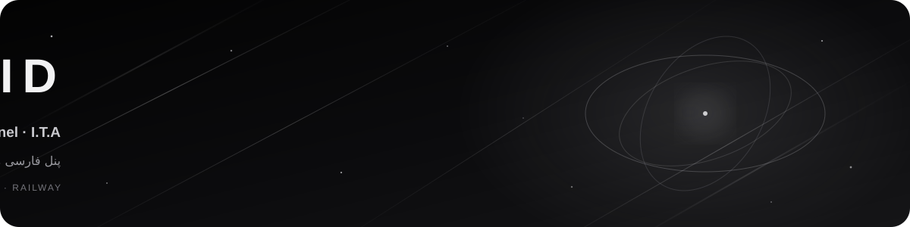
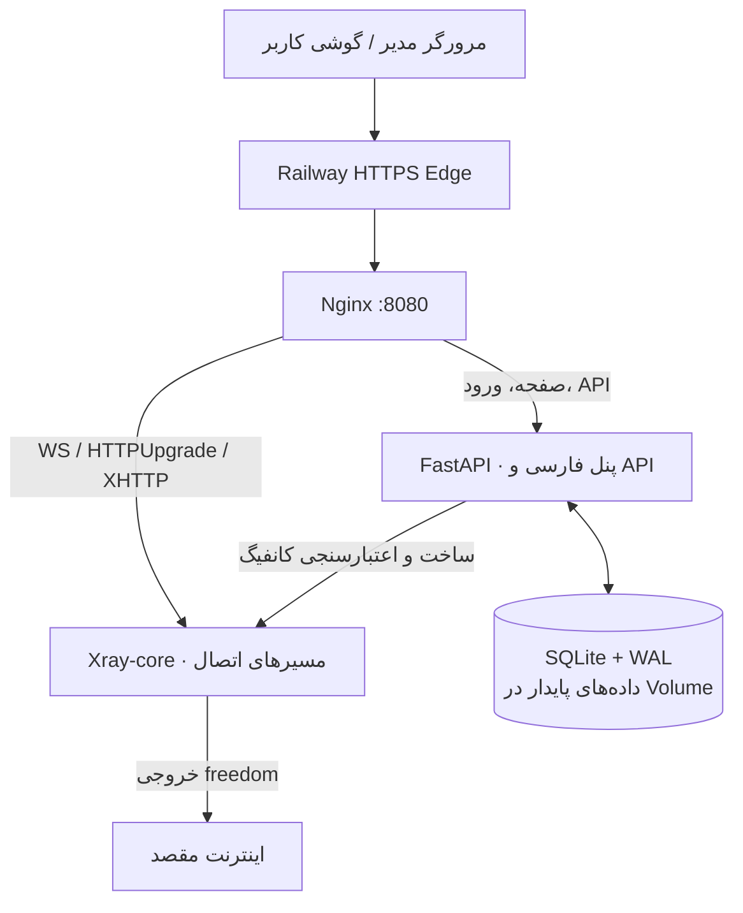
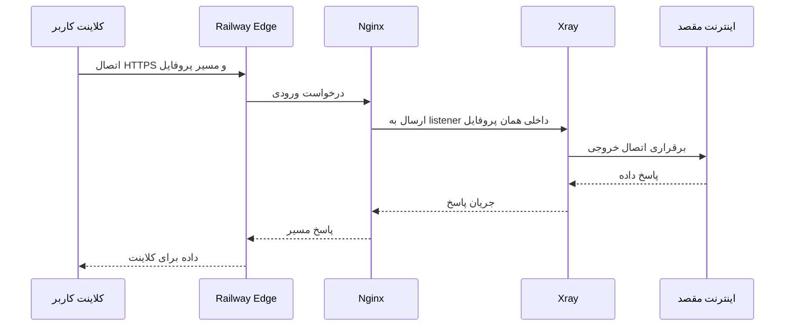
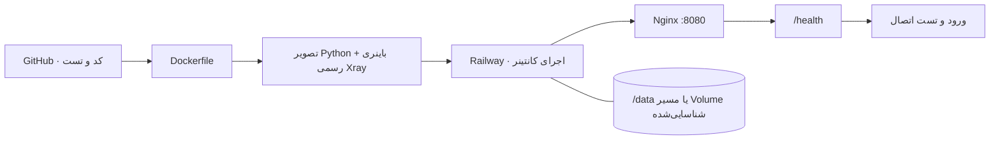

<div align="center">



# Void · Abyss Tunnel


<div dir="rtl" align="center">

**۱. دریافت لینک اشتراک**　→　**۲. واردکردن در برنامه**　→　**۳. اتصال**

</div>

<p dir="rtl" align="center">

[🧪 وضعیت تست‌ها](https://github.com/bodisbos-cmd/void/actions/workflows/tests.yml)　·　[🛡️ بررسی امنیت](https://github.com/bodisbos-cmd/void/actions/workflows/security.yml)　·　[✦ پیش‌نمایش بصری](https://github.com/bodisbos-cmd/void/actions/workflows/visual-preview.yml)

</p>

**پنل فارسی مدیریت سرویس‌های Xray با رابط واکنش‌گرا، اشتراک اختصاصی، سهمیه و پایش سرویس**

[شروع سریع](#شروع-سریع) · [راهنمای اتصال کاربران](docs/CONNECT_FA.md) · [راهنمای نصب ساده](docs/DEPLOY_FA.md) · [امکانات](#امکانات) · [نقشهٔ معماری](#نقشهٔ-معماری) · [راهنمای سرعت](docs/PERFORMANCE_FA.md) · [ماتریس امکانات](docs/FEATURE_MATRIX_FA.md)

</div>


## Void چیست؟

**Void** یک پنل مستقل برای مدیریت سرویس‌ها و پروفایل‌های اتصال مبتنی بر **Xray-core** است. رابط کاربری فارسی و راست‌چین است و برای اجرا در کانتینر Docker و استقرار روی Railway آماده شده. پنل برای مدیریت کاربران، لینک‌های اشتراک، گزارش مصرف، تنظیمات پروفایل و عیب‌یابی ساخته شده و به پنل‌های شخص ثالث وابستگی اجرایی ندارد.

> **وضعیت پروژه:** در مرحلهٔ آزمایش و یکپارچه‌سازی است. سبز بودن تست‌های خودکار، اتصال واقعی از تمام اپراتورها و کلاینت‌ها را تضمین نمی‌کند. پیش از استفادهٔ عمومی، کانفیگ‌ها را با گوشی و شبکه‌ای که قرار است از آن استفاده شود آزمایش کن.


## امکانات

| بخش | چه کاری انجام می‌دهد؟ |
|---|---|
| داشبورد | نمایش وضعیت سرویس، شاخص‌های منابع کانتینر، ترافیک ثبت‌شده و رویدادهای اخیر |
| مدیریت کاربران | ساخت، ویرایش، فعال/غیرفعال‌سازی، حذف و ریست مصرف کاربران |
| سهمیه و انقضا | تعیین سقف مصرف و زمان انقضا؛ غیرفعال‌سازی خودکار پس از رسیدن به محدودیت |
| لینک اشتراک | یک لینک برای صفحهٔ اختصاصی مرورگر یا محتوای اشتراک سازگار با کلاینت‌ها |
| QR و راهنما | نمایش QR، وضعیت سرویس و توضیح واردکردن لینک |
| پروفایل‌های اتصال | فعال‌سازی و غیرفعال‌سازی پروفایل‌های پشتیبانی‌شده و بازسازی امن تنظیمات Xray |
| پایش و گزارش‌ها | ثبت مصرف ساعتی هر کاربر، نمودارها و گزارش خطاها |
| عیب‌یابی | اعتبارسنجی پیکربندی Xray/Nginx و بررسی مسیرهای داخلی |
| نقش‌های مدیریتی | نقش‌های مالک، مدیر و مشاهده‌گر؛ مشاهده‌گر برای عملیات مدیریتی محدود است |
| API ربات | کلیدهای Bearer با مجوزهای محدود، تاریخ انقضا و امکان لغو |
| بکاپ و بازیابی | فایل ZIP پشتیبان با بررسی ساختار و تلاش برای rollback هنگام خطا |
| رابط موبایل | چیدمان واکنش‌گرا، منوی کناری، پشتیبانی از safe-area و کنترل‌های لمسی |

**دربارهٔ پینگ و سرعت:** آزمون «سنجش تأخیر» در صفحهٔ اشتراک، زمان پاسخ مسیر وب را از سمت سرور اندازه می‌گیرد؛ این عدد پینگ واقعی تونل از گوشی و سرعت دانلود/آپلود نیست. توضیحات و برنامهٔ آزمایش در [راهنمای عملکرد و سرعت](docs/PERFORMANCE_FA.md) آمده است.

**نام نمایشی کانفیگ‌ها:** در کلاینت فقط `abysstunnel 🇳🇱` نمایش داده می‌شود؛ نام کاربر و نام/نوع پروتکل به نام کانفیگ اضافه نمی‌شود، چون کلاینت نوع اتصال را خودش زیر آن نمایش می‌دهد. پرچم از `ABYSS_LOCATION_FLAG` می‌آید و برای استقرار در کشور دیگر می‌توان آن را تغییر داد. پروفایل‌های VLESS/Trojan/VMess روی WebSocket، early data را در لینک و inbound سرور هماهنگ می‌کنند؛ این کار ممکن است زمان برقراری اتصال را کم کند، اما تضمین افزایش پهنای باند نیست. پروفایل Shadowsocks از early data استفاده نمی‌کند.


## ایده‌های طراحی و مستندسازی

<div dir="rtl" align="right">

برای بهترشدن Void، ساختار راهنماها و شیوهٔ معرفی امکانات را با چند پروژهٔ شناخته‌شده مقایسه می‌کنیم؛ هدف کپی‌کردن ظاهر یا کد آن‌ها نیست، بلکه استفاده از الگوهای قابل‌فهم است:

- [Marzban](https://github.com/Gozargah/Marzban): معرفی روشن امکانات، فهرست مطالب و جداکردن راهنمای نصب از مستندات فنی.
- [Hiddify Manager](https://hiddify.com/manager/): آموزش مرحله‌به‌مرحله و توضیح جداگانهٔ بخش‌های پنل برای کسانی که تازه شروع کرده‌اند.
- [PasarGuard](https://github.com/PasarGuard/panel): گروه‌بندی قابلیت‌ها مثل مدیریت کاربران، لینک اشتراک، سهمیه و پایش.

از این الگوها برای بهبود راهنمای شروع، توضیح اصطلاحات، دسته‌بندی امکانات و عیب‌یابی استفاده می‌کنیم. این بخش صرفاً معرفی منابع الهام است؛ امکاناتی که هنوز در Void پیاده نشده‌اند، به‌عنوان قابلیت موجود معرفی نمی‌شوند.

</div>

## پروفایل‌های اتصال

نسخهٔ عادی ۱۳ پروفایل در کد تعریف می‌کند: ۹ پروفایل اصلی/جایگزین برای آزمایش و چهار حالت XHTTP از نوع stream-up/stream-one که آزمایشی و پیش‌فرض خاموش‌اند. اگر TCP Proxy در Railway برای پورت داخلی 10014 ساخته شود، پنل به‌صورت خودکار یک پروفایل چهاردهم اختیاری VLESS + REALITY + TCP مستقیم هم اضافه می‌کند؛ در غیر این صورت رفتار قبلی حفظ می‌شود.

| خانواده | پروفایل‌ها | وضعیت |
|---|---|---|
| VLESS | WebSocket، HTTPUpgrade، XHTTP auto، XHTTP packet-up | مسیرهای اصلی برای تست |
| مسیرهای جایگزین VLESS | WebSocket و HTTPUpgrade | برای مقایسهٔ سازگاری مسیر |
| XHTTP پیشرفته | stream-up، stream-one و دو مسیر جایگزین | آزمایشی؛ فعال‌سازی فقط پس از تست واقعی |
| پروتکل‌های دیگر | Trojan/WS، VMess/WS، Shadowsocks 2022/WS | پشتیبانی در کد؛ نیازمند تست کلاینت واقعی |

فهرست پروفایل‌ها به‌تنهایی تضمین سرعت یا پایداری نیست. هر مسیر را جداگانه روی همان دستگاه، سیم‌کارت/وای‌فای و کلاینت آزمایش کن. پروفایل مستقیم VLESS + REALITY/Vision فقط با فعال‌شدن TCP Proxy در Railway در دسترس می‌شود و هنوز باید از شبکهٔ واقعی کاربر سنجیده شود؛ [راهنمای سرعت](docs/PERFORMANCE_FA.md) را ببین.


## نقشهٔ معماری



### مسیر هر اتصال



### روند ساخت و انتشار




## شروع سریع

### راه‌اندازی روی Railway؛ از صفر تا اجرا

<div dir="rtl" align="right">

**۱. آماده‌کردن GitHub**

- اگر حساب نداری، از [صفحهٔ ثبت‌نام GitHub](https://github.com/signup) حساب بساز و وارد شو.
- [مخزن اصلی Void](https://github.com/bodisbos-cmd/void) را باز کن؛ روی **Star** بزن تا پروژه در فهرست علاقه‌مندی‌هایت بماند.
- روی **Fork** بزن و **Create fork** را انتخاب کن. از این به بعد، نسخهٔ خودت از پروژه را به Railway وصل می‌کنی.

**۲. وصل‌کردن پروژه به Railway**

- وارد [Railway](https://railway.com/) شو و **New Project** یا **Deploy** را بزن؛ گزینهٔ **GitHub Repo / Deploy from GitHub Repo** را انتخاب کن.
- اگر خواست، GitHub را به Railway وصل کن و دسترسی مخزن فورک‌شده‌ات را تأیید کن.
- از فهرست، مخزن فورک‌شدهٔ خودت با نام **void** را انتخاب کن. اگر در فهرست نبود، صفحهٔ فورک خودت را در GitHub باز کن، نشانی بالای مرورگر را کپی کن و در Railway وارد کن.
- روی **Deploy Now** بزن و صبر کن پروژه ساخته شود. اگر از تو روش ساخت پرسید، **Dockerfile** را انتخاب کن؛ لازم نیست فایلش را ویرایش کنی.

**۳. بازکردن تنظیمات سرویس**

پس از ساخته‌شدن پروژه، روی کارت سرویس **void** کلیک کن (در گوشی یک بار روی کارت بزن). وارد **Settings** شو. اگر صفحهٔ سرویس را نمی‌بینی، ابتدا پروژه را باز کن و کارت سرویس را انتخاب کن.

**۴. انتخاب کشور هلند**

در **Settings → Scale → Regions** منطقهٔ **EU West Metal (Amsterdam, Netherlands)** را انتخاب کن و تعداد نمونه‌ها را روی یک نگه دار. این کار را پیش از ساخت Volume انجام بده؛ جابه‌جایی منطقه پس از اتصال Volume ممکن است نیازمند انتقال داده و توقف موقت سرویس باشد.

**۵. نگه‌داشتن اطلاعات در Volume**

روی بوم پروژه، روی کارت سرویس راست‌کلیک کن (در گوشی این گزینه ممکن است درست کار نکند) و **Attach Volume** را انتخاب کن؛ اگر منو این گزینه را ندارد، از منوی سه‌نقطهٔ سرویس یا Command Palette استفاده کن. مسیر **Mount Path** را دقیقاً روی `/data` بگذار و تغییر را ذخیره کن. این فضا اطلاعات کاربران و تنظیمات را حفظ می‌کند؛ آن را حذف یا جابه‌جا نکن.

> **نکتهٔ موبایل:** برای ساخت و اتصال Volume، اگر گزینه در گوشی دیده نمی‌شود یا واکنش ندارد، Railway استفاده از مرورگر دسکتاپ را پیشنهاد می‌کند. بقیهٔ مراحل را می‌توانی با گوشی انجام بدهی.

**۶. تنظیم رمز مدیر**

در صفحهٔ سرویس، بخش **Variables** را باز کن و متغیر زیر را با یک رمز قوی و یکتا (حداقل ۱۴ نویسه) بساز:

`ABYSS_INITIAL_ADMIN_PASSWORD`

نام کاربری اولیه `admin` است؛ رمز را خودت در مقدار این متغیر تعیین می‌کنی. بدون این متغیر، اجرای تولیدی عمداً متوقف می‌شود.

**۷. ساخت دامنه و تنظیم پورت**

در **Settings → Networking → Public Networking** روی **Generate Domain** بزن. اگر فیلد **Port / Target Port / Custom Port** نمایش داده شد، مقدار **8080** را وارد کن و ذخیره کن. لازم نیست `:8080` را به انتهای آدرس عمومی اضافه کنی.

**۸. اجرای نهایی**

اگر Railway تغییرات را در حالت انتظار نگه داشته، دکمهٔ **Deploy** یا **Apply Changes** را بزن و منتظر بمان تا ساخت و استقرار تمام شود. در تب **Deployments** باید آخرین اجرا موفق باشد.

**۹. آزمایش پنل**

نشانی دامنه را باز کن و سپس `/health` را به انتهای آن اضافه کن؛ پاسخ سالم باید نمایش داده شود. بعد با نام کاربری `admin` و رمزی که تنظیم کردی وارد شو و ساخت یک کاربر آزمایشی و بازشدن لینک اشتراک را بررسی کن.

</div>

برای جزئیات پیشرفته‌تر، متغیرهای اختیاری، بکاپ و آزمایش پروفایل‌ها، [راهنمای کامل نصب و انتشار](docs/DEPLOY_FA.md) را ببین.

**آیا می‌شود Volume را کاملاً خودکار ساخت؟** خود برنامه می‌تواند مسیر Volume متصل‌شده را تشخیص بدهد، اما از داخل کانتینر نمی‌تواند یک Volume پایدار جدید در حساب Railway بسازد و به سرویس وصل کند. Volume باید یک‌بار از پنل Railway یا CLI ایجاد و متصل شود. اگر CLI را به پروژه و سرویس درست وصل کرده‌ای، راهنمای رسمی [مدیریت Volume با CLI](https://docs.railway.com/cli/volume) را ببین؛ برای مثال دستور ساخت Volume با مسیر `/data`، `railway volume add --mount-path /data` است. برای سرویس فعلی، Volume موجود را حذف یا جابه‌جا نکن.

جزئیات نصب و نگهداری: [راهنمای نصب فارسی](docs/DEPLOY_FA.md).

### اجرای آزمایشی محلی با Docker

```bash
docker build -t void .
docker run --rm -p 8080:8080 -e COOKIE_SECURE=0 -v "$PWD/data:/data" void
```

سپس `http://localhost:8080` را باز کن. این Volume محلی دیتابیس را بین اجرای کانتینرها حفظ می‌کند. متغیر `COOKIE_SECURE=0` فقط برای تست محلی با HTTP است؛ برای سایت عمومی آن را غیرفعال نکن.


## منابع فشار و بهینه‌سازی

چند بهینه‌سازی کم‌خطر در کد وجود دارد:

- لایهٔ نصب Python در Docker قابل کش است و دانلودهای pip در build cache نگهداری می‌شوند تا rebuildها کم‌هزینه‌تر شوند.
- ذرات پس‌زمینه با تعداد و نرخ فریم محدودتر رسم می‌شوند؛ تعامل لمسی حفظ شده و حرکت پس‌زمینه از تغییر مداوم `background-position` به transform کم‌هزینه‌تر منتقل شده است.
- برای پاک‌سازی تاریخچهٔ مصرف، SQLite یک ایندکس اختصاصی بر زمان نمونه دارد؛ این کار اسکن بی‌دلیل تمام رکوردهای قدیمی را کاهش می‌دهد.
- مسیر Volume در اجرا از تنظیم صریح `DATA_DIR` یا متغیر خودکار Railway تشخیص داده می‌شود.
- اسکن کامل تاریخچهٔ مصرف و پاک‌سازی رکوردهای منقضی‌شده حداکثر ساعتی اجرا می‌شوند؛ کنترل سهمیه و انقضا همچنان در چرخهٔ مانیتور اجرا می‌ماند.
- لاگ Xray به‌صورت چرخشی نگهداری می‌شود تا خطای تکرارشونده فضای Volume را بی‌نهایت مصرف نکند.

سرعت پایین تونل را صرفاً با تنظیمات CSS یا افزایش تعداد پروفایل‌ها نمی‌توان حل کرد. منطقهٔ استقرار، محدودیت شبکه/Edge، پورت‌های قابل‌دسترسی اپراتور، ظرفیت پلن و روش انتقال همگی مؤثرند. روش اندازه‌گیری و تفاوت مسیر فعلی HTTPS با TCP Proxy در [راهنمای عملکرد و سرعت](docs/PERFORMANCE_FA.md) شرح داده شده است.


## راهنمای بخش‌های پنل

| بخش | کاربرد |
|---|---|
| داشبورد | سلامت سرویس و شاخص‌های فعلی؛ عدد «سرعت ثبت‌شده» معیار سرعت‌سنج گوشی نیست |
| مدیریت کاربران | ساخت سرویس، سهمیه، انقضا، وضعیت و لینک اشتراک |
| سرورها و پروتکل‌ها | وضعیت پروفایل‌های فعلی و فعال/غیرفعال‌کردن آن‌ها |
| گزارش‌ها | مشاهدهٔ رویدادها و خطاهای اخیر |
| تنظیمات | کنترل‌های پنل، پروفایل‌ها و گزینه‌های اجرایی موجود |
| پایش | CPU، RAM، دیسک، Load و مصرف ثبت‌شدهٔ کانتینر |
| عیب‌یابی | آزمون محلی listener، مسیر Nginx و اعتبارسنجی تنظیمات؛ نه آزمون کامل گوشی کاربر |
| API و اتصال ربات | ساخت و لغو کلیدهای مجوزدار برای اتصال بات |
| بکاپ و بازیابی | دریافت نسخهٔ پشتیبان و بازیابی دادهٔ پنل |

برای اطلاعات فنی:
- [نقشهٔ معماری و ساختار کد](docs/ARCHITECTURE_FA.md)
- [راهنمای نصب و انتشار](docs/DEPLOY_FA.md)
- [راهنمای عملکرد، سرعت و محدودیت‌های Railway](docs/PERFORMANCE_FA.md)
- [ماتریس وضعیت قابلیت‌ها](docs/FEATURE_MATRIX_FA.md)
- [API فارسی](docs/API_FA.md)
- [مرور امنیتی](docs/SECURITY_REVIEW.md)


## ساختار اصلی مخزن

| مسیر | وظیفه |
|---|---|
| `app/main.py` | برنامهٔ FastAPI، مدل داده، مدیریت کاربران، ساخت کانفیگ Xray، HTML/CSS/JS و صفحهٔ اشتراک |
| `app/extended.py` | APIهای مدیریتی پیشرفته، کلیدهای API، پایش منابع و تشخیص مسیرها |
| `nginx/nginx.conf` | تنظیمات اصلی Nginx و اتصال‌های داخلی محدودشده |
| `nginx/default.conf` | مسیریابی وب و حمل‌ونقل به listenerهای Xray |
| `scripts/start.sh` | آماده‌سازی مسیر داده، بررسی دسترسی‌ها و اجرای Nginx و FastAPI |
| `Dockerfile` | ساخت تصویر با نسخهٔ مشخص Xray-core و نصب وابستگی‌های Python |
| `tests/` | تست‌های هسته، API، تنظیمات استقرار و رگرسیون |
| `.github/workflows/` | تست‌ها، بررسی امنیت وابستگی‌ها و اسکرین‌شات‌های خودکار |

## امنیت و نکات مهم

- لینک اشتراک مثل رمز عبور است؛ فقط برای صاحب سرویس ارسالش کن.
- رمز پیش‌فرض `admin` را فوراً تغییر بده.
- فایل بکاپ ممکن است اطلاعات کاربران، هش اعتبارنامه‌ها و تنظیمات را داشته باشد؛ آن را محرمانه نگه دار.
- Volume حاوی دیتابیس و تنظیمات است. حذف، detach یا تغییر محل آن می‌تواند اطلاعات را از دسترس خارج کند.
- تست مسیر داخلی یا CI جایگزین تست با اپلیکیشن واقعی، شبکهٔ مقصد و بررسی امنیتی مستقل نیست.
- استقرار فعلی برای مسیرهای HTTP/HTTPS روی Railway طراحی شده است. UDP عمومی و WireGuard مستقیم در این معماری فعال نیست.

## وضعیت تست‌ها و پیش‌نمایش

در تب [Actions](https://github.com/bodisbos-cmd/void/actions)، خروجی تست Python، ساخت تصویر و تست مسیرهای Xray را بررسی کن. گردش کار [Visual preview](https://github.com/bodisbos-cmd/void/actions/workflows/visual-preview.yml) هم از دادهٔ ساختگی و محیط ایزوله برای بررسی صفحات دسکتاپ، تبلت و موبایل استفاده می‌کند؛ هیچ داده‌ای از Railway عملیاتی در آن استفاده نمی‌شود.

---

<div align="center">

**Void · Abyss Tunnel**

<sub>طراحی برای سادگی مدیریت؛ تأیید سرعت و سازگاری، همیشه با آزمایش واقعی انجام می‌شود.</sub>

</div>
