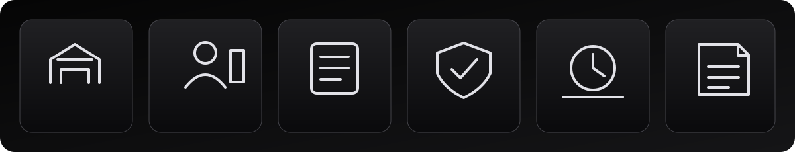
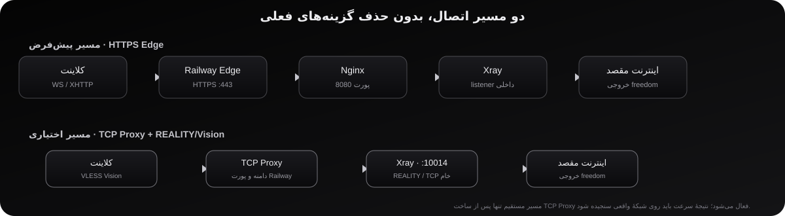

**پنل فارسی و راست‌چین مدیریت سرویس‌های Xray**

[شروع سریع](#شروع-سریع) · [اتصال کاربران](docs/CONNECT_FA.md) · [نصب مدیر پنل](docs/DEPLOY_FA.md) · [امکانات](#امکانات) · [پرسش‌های رایج](#پرسشهای-رایج)

## Void چیست؟

**Void** یک پنل فارسی برای ساخت و مدیریت سرویس‌های اتصال مبتنی بر **Xray** است. مدیر می‌تواند کاربر بسازد، حجم و زمان سرویس را تعیین کند و برای هر کاربر یک لینک اشتراک بسازد.

> **وضعیت پروژه:** هنوز در مرحلهٔ آزمایش و یکپارچه‌سازی است. سبز بودن تست‌های خودکار به معنی تضمین اتصال روی همهٔ گوشی‌ها و اپراتورها نیست؛ قبل از استفادهٔ عمومی، اتصال واقعی را آزمایش کن.

## شروع سریع

### می‌خواهی فقط به سرویس وصل شوی؟

1. لینک اشتراکی را که مدیر برایت فرستاده باز کن یا کپی کن.
2. برنامهٔ سازگار را نصب کن.
3. لینک را در بخش **Add subscription / Import from URL** وارد کن.
4. فهرست را **Update / Refresh** کن.
5. یک اتصال انتخاب کن و **Connect** را بزن.

راهنمای قدم‌به‌قدم با توضیح ساده و لینک دانلود برنامه‌ها: [راهنمای اتصال کاربران](docs/CONNECT_FA.md).

### می‌خواهی خود پنل را نصب کنی؟

این قسمت برای **مدیر سرور** است، نه کاربری که فقط می‌خواهد وصل شود.

1. مخزن را به سرویس Railway وصل کن و روش ساخت را روی **Dockerfile** بگذار.
2. یک **Volume پایدار** با مسیر **/data** به سرویس وصل کن تا اطلاعات پس از انتشار نسخهٔ جدید باقی بماند. Volume را بعداً حذف یا جابه‌جا نکن.
3. برای سرویس دامنهٔ عمومی بساز و پورت داخلی **8080** را در نظر بگیر.
4. در نصب تازه، نام کاربری و رمز اولیه **admin** است. **پیش از عمومی‌کردن پنل، فوراً رمز را عوض کن.**
5. بعد از انتشار، آدرس **https://دامنه-تو/health** را باز کن و وضعیت سرویس را بررسی کن.

راهنمای کامل‌تر: [راهنمای نصب و انتشار](docs/DEPLOY_FA.md).

## امکانات

- **داشبورد:** مشاهدهٔ وضعیت سرویس و آمار ثبت‌شده.
- **مدیریت کاربران:** ساخت، ویرایش، توقف و حذف سرویس کاربران.
- **حجم و انقضا:** تعیین سقف مصرف و تاریخ پایان سرویس.
- **لینک اشتراک و QR:** راه آسان برای واردکردن اتصال‌ها در برنامه.
- **پروفایل‌های مختلف:** امکان آزمایش چند روش اتصال و انتخاب مسیر سازگارتر.
- **گزارش و عیب‌یابی:** مشاهدهٔ رویدادها و خطاهای پایه.
- **بکاپ و بازیابی:** تهیهٔ نسخهٔ پشتیبان از اطلاعات پنل.
- **API:** اتصال کنترل‌شده به ربات‌ها یا ابزارهای دیگر با کلیدهای مجوزدار.
- **نمایش واکنش‌گرا:** قابل استفاده روی گوشی، تبلت و رایانه.

## یک اتصال از کجا عبور می‌کند؟

به زبان ساده: برنامهٔ گوشی درخواست را می‌فرستد، سرویس Void آن را از مسیر پشتیبانی‌شده عبور می‌دهد و Xray اتصال را به مقصد می‌رساند. لازم نیست کاربر این بخش فنی را تنظیم کند.

**نکته دربارهٔ پینگ:** عدد «سنجش تأخیر» در صفحهٔ اشتراک زمان پاسخ درخواست وب از سمت سرور است؛ پینگ واقعی تونل از گوشی و سرعت دانلود/آپلود نیست. برای مقایسهٔ دقیق، از تست داخل برنامه و همان شبکه‌ای که استفاده می‌کنی کمک بگیر.

## پرسش‌های رایج

**لینک اشتراک را کجا وارد کنم؟**  
داخل برنامه، گزینه‌ای مانند **Add subscription** یا **Import from URL** را پیدا کن. لازم نیست آدرس سرور یا تنظیمات پروتکل را دستی وارد کنی.

**چرا چند اتصال در فهرست دیده می‌شود؟**  
این‌ها روش‌های مختلف اتصال‌اند. یکی را امتحان کن؛ اگر کار نکرد، مورد دیگری را انتخاب کن.

**اگر بعد از Update هنوز وصل نشد چه کنم؟**  
وضعیت سرویس و حجم باقی‌مانده را بررسی کن، اتصال دیگری را امتحان کن و متن خطا را برای پشتیبانی بفرست. لینک خصوصی اشتراک را منتشر نکن.

**چرا سرعت در همهٔ شبکه‌ها یکسان نیست؟**  
نتیجه به دستگاه، اپراتور، مسیر شبکه، منطقهٔ سرور و محدودیت‌های سرویس بستگی دارد. وجود چند پروفایل به‌تنهایی سرعت بالاتر را تضمین نمی‌کند.

**آیا سبز بودن تست‌ها یعنی همه‌چیز حتماً کار می‌کند؟**  
خیر. تست خودکار خطاهای مشخص نرم‌افزاری را پیدا می‌کند؛ اتصال واقعی باید جداگانه روی دستگاه و شبکهٔ موردنظر آزمایش شود.

## راهنماهای تکمیلی

- [راهنمای اتصال کاربران، مرحله‌به‌مرحله](docs/CONNECT_FA.md)
- [راهنمای نصب و انتشار برای مدیر](docs/DEPLOY_FA.md)
- [راهنمای نصب محلی با Docker](docs/DEPLOY_DOCKER_FA.md)
- [راهنمای معماری پروژه](docs/ARCHITECTURE_FA.md)
- [راهنمای عملکرد و معنی پینگ/سرعت](docs/PERFORMANCE_FA.md)
- [فهرست وضعیت قابلیت‌ها](docs/FEATURE_MATRIX_FA.md)
- [مستندات API](docs/API_FA.md)
- [نکات امنیتی](docs/SECURITY_REVIEW.md)

## امنیت

- لینک اشتراک را مثل رمز عبور محرمانه نگه دار.
- رمز پیش‌فرض مدیر را قبل از استفادهٔ عمومی تغییر بده.
- فایل پشتیبان ممکن است اطلاعات حساس داشته باشد؛ آن را عمومی نکن.
- حذف یا جداکردن Volume می‌تواند اطلاعات پنل را از دسترس خارج کند.
- استفاده از این پروژه نیازمند آزمایش و رعایت قوانین و شرایط سرویس‌دهندهٔ میزبانی است.

---

**Void · Abyss Tunnel**

مدیریت ساده‌تر، توضیحات روشن‌تر؛ اتصال واقعی همیشه باید آزمایش شود.

