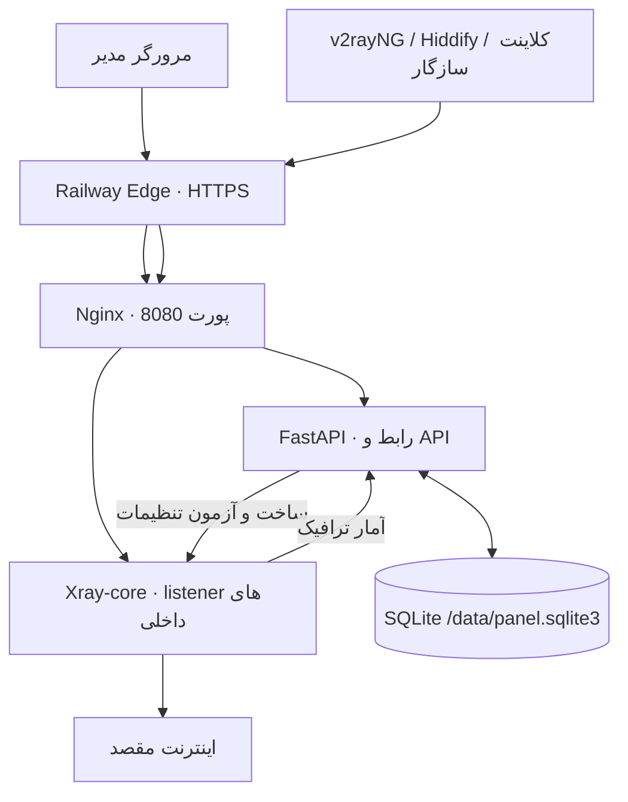
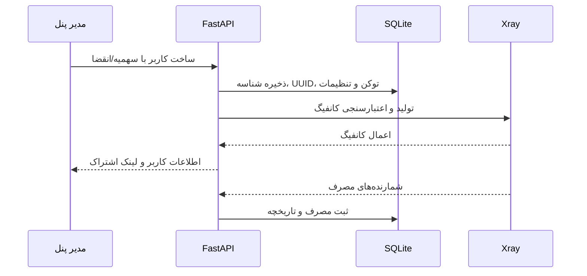

# معماری Void و راهنمای ساختار کد

این سند توضیح می‌دهد هر بخش کجاست، چه مسئولیتی دارد و درخواست‌ها چگونه بین پنل، Nginx، Xray و دیتابیس حرکت می‌کنند.

## نمای کلی

**مسیر اختیاری مستقیم:** اگر Railway TCP Proxy به پورت 10014 متصل شود، یک listener VLESS + REALITY/Vision روی TCP با bind مشخص به همان پورت اضافه می‌شود و ترافیک آن از Nginx عبور نمی‌کند. بدون متغیرهای خودکار TCP Proxy این listener ساخته نمی‌شود.

**اصل مهم:** Nginx تنها ورودی وب کانتینر است. listenerهای عادی Xray در تنظیم فعلی روی loopback قرار دارند و Nginx مسیرهای WS، HTTPUpgrade و XHTTP را به listener متناسب هدایت می‌کند. این طراحی برای استقرار HTTP/HTTPS روی Railway است و به‌معنای وجود ورودی عمومی UDP یا WireGuard نیست.

## فایل‌ها و ماژول‌ها

| فایل | مسئولیت |
|---|---|
| `app/main.py` | برنامهٔ FastAPI، ساخت و مهاجرت SQLite، نشست/ورود، اعتبارسنجی ورودی، مدیریت کلاینت‌ها، سهمیه و انقضا، تولید کانفیگ Xray، کنترل process و رابط HTML/CSS/JS |
| `app/extended.py` | API مدیریتی پیشرفته، حساب‌های مدیر و نقش‌ها، API keyها، گزارش سیستم، پایش منابع، بررسی مسیرهای پروفایل و عملیات بکاپ/بازیابی |
| `nginx/nginx.conf` | تنظیمات سطح اصلی Nginx، worker، اتصال‌های هم‌زمان و upstream keepalive |
| `nginx/default.conf` | مسیریابی پورت 8080 به FastAPI یا listener داخلی پروفایل‌های Xray |
| `scripts/start.sh` | انتخاب مسیر داده، آماده‌سازی دسترسی Volume، تست نوشتن روی دیتابیس، آزمون Nginx و اجرای Nginx و Uvicorn |
| `Dockerfile` | تصویر پایهٔ Python، دریافت نسخهٔ مشخص Xray از تصویر رسمی، نصب وابستگی‌ها و آماده‌سازی کاربر غیر root |
| `railway.json` | تنظیم build و health check برای سرویس Railway؛ به‌تنهایی Volume پایدار ایجاد نمی‌کند |
| `scripts/smoke_transports.py` | smoke test اتصال‌های حمل‌ونقل در محیط ایزوله |
| `tests/` | تست‌های هسته، API، مجوزها، دیتابیس، تنظیمات استقرار و رگرسیون رابط |
| `.github/workflows/tests.yml` | تست پایتون، ساخت کانتینر، تست مسیرهای Xray و ماندگاری داده بعد از restart |
| `.github/workflows/security.yml` | بررسی خودکار وابستگی‌ها |
| `.github/workflows/visual-preview.yml` | اجرای نمونهٔ ایزوله با دادهٔ ساختگی و گرفتن اسکرین‌شات‌های دسکتاپ، تبلت و موبایل |

## مسیر ساختن یک سرویس کاربر

عملیات نوشتن به دیتابیس از طریق context manager کوتاه‌عمر انجام می‌شود؛ SQLite با WAL و foreign keys کار می‌کند. قبل از restart عادی Xray، پنل تلاش می‌کند آمار جمع‌شده را ذخیره کند تا مصرف ترافیک بی‌دلیل از دست نرود. تاریخچهٔ هر کاربر به‌صورت نمونه‌های ساعتی نگهداری می‌شود و سیاست نگهداری فعلی ۹۰ روز است.

## نقش‌های مدیریتی و داده‌ها

- **مالک (owner):** دسترسی به مدیران، کلیدهای API و بکاپ/بازیابی.
- **مدیر (admin):** مدیریت کاربران و امکانات مجاز پنل.
- **مشاهده‌گر (viewer):** دسترسی خواندنی؛ عملیات تغییر وضعیت باید رد شود.
- **لینک اشتراک:** دارندهٔ لینک می‌تواند به پروفایل‌های همان سرویس دسترسی داشته باشد؛ آن را مانند رمز عبور نگه دار.
- **Volume:** فایل دیتابیس، پیکربندی تولیدشده و فایل‌های عملیاتی زیر مسیر داده ذخیره می‌شوند. مسیر پیش‌فرض `/data` است و مقدار خودکار `RAILWAY_VOLUME_MOUNT_PATH` نیز خوانده می‌شود.

## مسیر یک اتصال

1. کلاینت به دامنهٔ عمومی وصل می‌شود.
2. Railway Edge اتصال HTTPS را می‌پذیرد و ترافیک وب را به سرویس می‌رساند.
3. Nginx بر اساس path، درخواست را به FastAPI یا listener مختص پروفایل می‌فرستد.
4. Xray احراز هویت کاربر را بررسی می‌کند و ترافیک را از outbound فعال عبور می‌دهد.
5. شمارنده‌های Xray در مانیتور دوره‌ای خوانده می‌شوند و به سابقهٔ همان کاربر اضافه می‌شوند.

زمان پاسخ مسیر وب، handshake پروفایل و سرعت دانلود یک چیز نیستند. برای سنجش عملی به [راهنمای عملکرد و سرعت](PERFORMANCE_FA.md) مراجعه کن.

## پیشنهاد برای مشارکت در کد

- تغییر schema دیتابیس را با migration سازگار و تست دادهٔ قدیمی همراه کن.
- پیش از تغییر لینک‌های اشتراک، URI نهایی را با کلاینت واقعی بررسی کن؛ تست HTML یا HTTP 200 به‌تنهایی کافی نیست.
- مسیرهای آزمایشی را در رابط با برچسب آزمایشی نگه دار تا مدیر آن‌ها را با مسیرهای تأییدشده اشتباه نگیرد.
- هیچ شناسه، UUID، توکن اشتراک، بکاپ یا رمز واقعی را داخل تست، README، اسکرین‌شات یا GitHub commit قرار نده.
- هر تغییر UI باید هم از عرض موبایل و هم حالت «Desktop site» مرورگر موبایل آزمایش شود.
