# راهنمای نصب و انتشار Void · Abyss Tunnel روی Railway

این راهنما برای راه‌اندازی پنل خودت است. اگر هنوز فورک پروژه را نساخته‌ای، اول [مخزن Void در GitHub](https://github.com/bodisbos-cmd/void) را باز کن.

## ۱. ساخت حساب و فورک پروژه

1. اگر حساب GitHub نداری، از [github.com/signup](https://github.com/signup) ثبت‌نام کن.
2. [مخزن اصلی Void](https://github.com/bodisbos-cmd/void) را باز کن و روی **Star** بزن.
3. روی **Fork** و سپس **Create fork** بزن. این نسخهٔ شخصی پروژه است که به Railway وصل می‌کنی.

## ۲. ساخت پروژه در Railway

1. وارد [Railway](https://railway.com/) شو و **New Project** یا **Deploy** را بزن.
2. **GitHub Repo / Deploy from GitHub Repo** را انتخاب کن. اگر خواست، حساب GitHub را وصل کن و دسترسی Railway به فورک را تأیید کن.
3. فورک خودت با نام **void** را از فهرست انتخاب کن. اگر نمایش داده نشد، دسترسی Railway به فورک را در تنظیمات GitHub بررسی کن؛ سپس نشانی صفحهٔ فورک را در Railway وارد کن. در گوشی، اگر GitHub داخل اپ باز شده، از **Share → Copy link** استفاده کن.
4. روی **Deploy Now** بزن و منتظر بمان پروژه ساخته شود.

## ۳. تنظیم سرویس

پس از ساخته‌شدن پروژه، کارت سرویس **void** را انتخاب کن (روی دسکتاپ کلیک کن؛ در گوشی یک بار روی کارت بزن). تنظیمات بعدی از همین صفحه انجام می‌شوند.

### کشور: هلند

به **Settings → Scale → Regions** برو و **EU West Metal (Amsterdam, Netherlands)** را انتخاب کن. تعداد نمونه‌ها را روی یک نگه دار. این کار را پیش از ساخت Volume انجام بده.

### ذخیره‌سازی: مسیر `/data`

**موبایل:** روی کارت سرویس **void** چند لحظه نگه دار تا منو باز شود و **Attach Volume** را انتخاب کن.

**دسکتاپ:** روی فضای خالی بوم پروژه راست‌کلیک کن و گزینهٔ ساخت Volume را بزن. اگر منو باز نشد، `Ctrl + K` (در مک `⌘ + K`) را بزن و `Volume` را جست‌وجو کن.

سرویس **void** را انتخاب کن، در **Mount Path** دقیقاً `/data` بنویس و ذخیره کن. Volume اطلاعات پنل را نگه می‌دارد؛ آن را حذف نکن. [راهنمای رسمی Railway](https://docs.railway.com/volumes)

### ورود به پنل

بعد از پایان استقرار، دامنه‌ای را که Railway ساخته باز کن تا صفحهٔ ورود پنل نمایش داده شود. نام کاربری و رمز اولیه هر دو `admin` هستند. پس از ورود، رمز را از داخل پنل تغییر بده.

### دامنه و پورت

به **Settings → Networking → Public Networking** برو و **Generate Domain** را بزن. اگر فیلد **Port / Target Port / Custom Port** نمایش داده شد، عدد **8080** را وارد کن. پورت را به انتهای آدرس دامنه اضافه نکن.

### استقرار نهایی

پس از تنظیم منطقه، Volume و دامنه، اگر Railway تغییرات را در حالت انتظار نگه داشته است، **Deploy** یا **Apply Changes** را بزن و تا پایان build و deploy صبر کن. در **Deployments** بررسی کن که آخرین اجرا موفق باشد.

## ۴. آزمایش اولیه

1. دامنهٔ ساخته‌شده را باز کن و مطمئن شو صفحهٔ ورود پنل نمایش داده می‌شود.
2. وارد پنل شو و رمز اولیه را تغییر بده.
3. یک کاربر آزمایشی بساز و لینک اشتراک را در برنامهٔ سازگار امتحان کن.
4. پیش از استفادهٔ عمومی، از بخش بکاپ یک نسخه بگیر و آن را بیرون از سرویس نگه دار.

## ۵) ساخت سرویس برای مشتری
1. در «مدیریت کاربران»، نام، مدت روز و حجم GB را وارد کن.
2. خالی‌گذاشتن مدت یعنی بدون انقضا و خالی‌گذاشتن حجم یعنی نامحدود.
3. پس از ساخت، «لینک اشتراک» را باز کن.
4. **همان لینک اشتراک** در مرورگر صفحهٔ اختصاصی شامل وضعیت سرویس، QR، راهنما، عیب‌یابی و دانلود رسمی را باز می‌کند؛ در برنامهٔ سازگار همان URL به محتوای Base64 اشتراک تبدیل می‌شود.
5. نام هر کانفیگ در کلاینت `abysstunnel 🇳🇱` است؛ نوع پروتکل را خود برنامه زیر نام نشان می‌دهد، بنابراین نوع و نام کاربر در عنوان تکرار نمی‌شوند. برای استقرار در کشور دیگر، متغیر `ABYSS_LOCATION_FLAG` را روی پرچم درست بگذار.
6. **لینک خام اشتراک** را برای Import/Subscription داخل برنامه سازگار بده. لینک اشتراک مثل رمز است؛ فقط به همان مشتری ارسالش کن.
7. غیرفعال‌کردن یا حذف سرویس، دسترسی لینک اشتراک را قطع می‌کند. مصرف و انقضا در داشبورد پایش می‌شوند.

## ۶) اتصال ربات فروش
1. در بخش «API و اتصال ربات» یک کلید بساز.
2. فقط مجوزهای لازم را انتخاب کن: مشاهده کاربران، مدیریت کاربران، لینک اشتراک، و در صورت نیاز پایش و آمار.
3. کلید خام فقط یک بار نمایش داده می‌شود. آن را در secret/environment variable ربات ذخیره کن.
4. API از `Authorization: Bearer <TOKEN>` استفاده می‌کند؛ مستندات در [API_FA.md](API_FA.md) هستند.
5. اگر کلید افشا شد، آن را فوراً لغو و یک کلید جدید بساز.

## ۷) پروفایل‌ها، پینگ و سرعت
کد ۱۳ پروفایل تعریف می‌کند؛ ۹ پروفایل اصلی/جایگزین برای استفادهٔ عادی در نظر گرفته شده‌اند و چهار حالت XHTTP از نوع stream-up/stream-one آزمایشی‌اند و در تست فعلی به‌صورت پیش‌فرض خاموش می‌مانند. تعداد بیشتر پروفایل یا پینگ کمتر به‌تنهایی سرعت دانلود و آپلود را تضمین نمی‌کند.
1. یک سرویس آزمایشی بساز و همان لینک اشتراک را وارد کلاینت کن.
2. ابتدا WebSocket، HTTPUpgrade، XHTTP auto و XHTTP packet-up را جداگانه تست کن.
3. برای هرکدام دست‌کم سه بار در شرایط مشابه، پینگ داخل کلاینت، دانلود، آپلود و پایداری اتصال را ثبت کن.
4. دکمهٔ «سنجش تأخیر» در صفحهٔ اشتراک زمان پاسخ مسیر HTTP را از سمت سرور اندازه می‌گیرد، نه پینگ واقعی گوشی از داخل تونل.
5. چهار حالت stream-up/stream-one را فقط به‌صورت آزمایشی فعال کن و بعد از تست کلاینت خاموششان کن اگر نتیجه پایدار نیست.
6. اگر پروفایلی وصل نشد، لاگ‌های Railway و `/data/xray-stderr.log` را بررسی کن. لینک خصوصی و توکن را در گزارش عمومی نگذار.
7. بررسی معماری مستقیم TCP/REALITY و روش تست سرعت در [راهنمای عملکرد](PERFORMANCE_FA.md) آمده است؛ این روش در حال حاضر فعال نشده و نیاز به تنظیم یک‌بارهٔ TCP Proxy در Railway دارد.

## ۸) پروفایل مستقیم TCP (اختیاری)

اگر می‌خواهی مسیر مستقیم‌تر را آزمایش کنی، پس از گرفتن بکاپ می‌توانی در Railway → Settings → Networking یک TCP Proxy بسازی و **پورت داخلی 10014** را انتخاب کنی. Railway دامنه و پورت عمومی را خودش ایجاد می‌کند. پس از آن، در اجرای بعدی پنل پروفایل «VLESS · REALITY · TCP مستقیم» را خودکار نمایش می‌دهد.

این مرحله اختیاری است و برای بالا آمدن پنل لازم نیست. پروفایل‌های وب فعلی باقی می‌مانند. Railway برای هر سرویس فقط یک TCP Proxy دارد؛ بعضی شبکه‌های موبایل ممکن است پورت TCP اختصاص‌یافته را مسدود کنند، پس ابتدا با یک سرویس آزمایشی بررسی کن. راهنمای کامل در [راهنمای عملکرد](PERFORMANCE_FA.md) است.

## ۹) بکاپ و نگهداری
- بکاپ ZIP حاوی دیتابیس، مشتری‌ها، تنظیمات، رویدادها و هش اعتبارنامه‌هاست؛ محرمانه نگهش دار.
- بازیابی، اطلاعات فعلی را جایگزین می‌کند. اول از دیتابیس جاری بکاپ بگیر.
- Volume را حذف نکن؛ حذف آن می‌تواند دیتابیس و کلید نشست را از بین ببرد.
- پس از انتشار نسخهٔ جدید، `/health` را باز کن و سپس ورود، ساخت کاربر، لینک اشتراک، API و پروفایل‌ها را بررسی کن.
- روش آماده‌سازی دیتابیس و مسیرهای Volume در [راهنمای معماری](ARCHITECTURE_FA.md) و نکات سرعت/کش build در [راهنمای عملکرد](PERFORMANCE_FA.md) شرح داده شده است.

## ۱۰) معنی شاخص‌های داشبورد
- CPU/RAM/disk/load: منابعی که کانتینر می‌بیند؛ لزوماً با کل میزبان یا محدودیت پلن یکسان نیست.
- مصرف ثبت‌شده: داده‌ای که از آمار Xray جمع شده است.
- نرخ ترافیک: تغییر مصرف ثبت‌شده بین دو نمونه‌برداری؛ معیار سرعت‌سنج اینترنت مشتری نیست.
- زمان پاسخ صفحه اشتراک: پاسخ HTTP است، نه پینگ داخل تونل.

## ۱۱) وضعیت امنیت
تست خودکار، بررسی ایستا و تست مسیرهای برنامه جایگزین تست نفوذ مستقل یا تست شبکه واقعی نیست. پیش از فروش عمومی، دسترسی‌های نقش‌ها، بکاپ/بازیابی، محدودیت نرخ، و اتصال از شبکه‌های هدف را در محیط آزمایشی بررسی کن.
